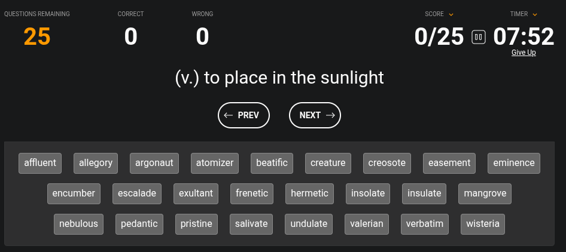
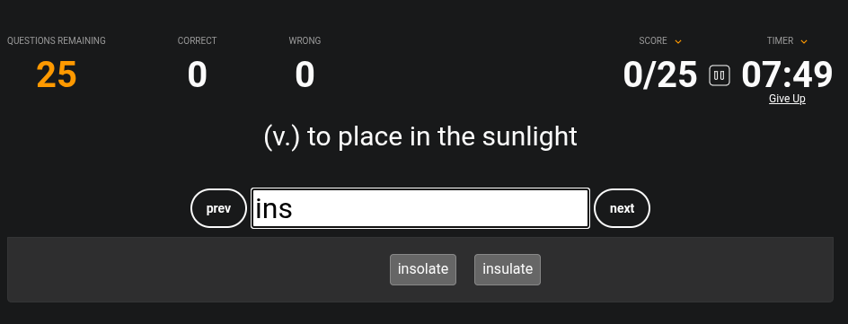
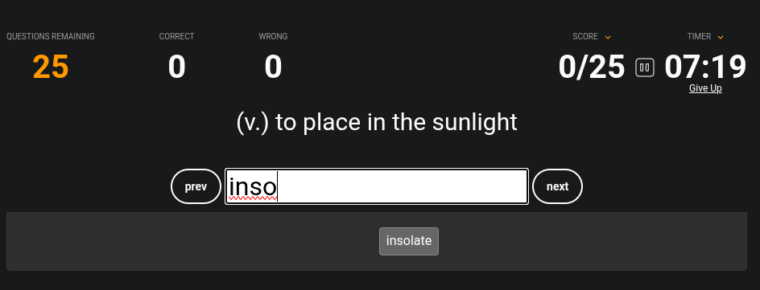
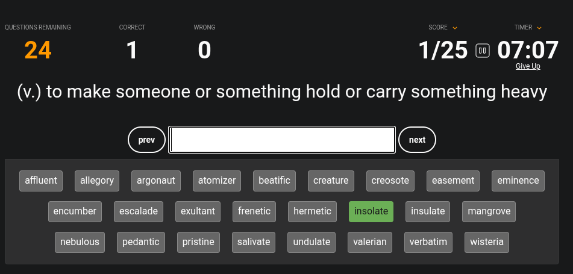

# Introduction

This is a Chromium extension which enables typing your answers instead of only being able to click them. Works on clickable Sporcle quizzes, such as [this one](https://www.sporcle.com/games/DesertSpartan/8-letter-vocabulary-hard).

# What it does

Without the extension, a typical clickable quiz on Sporcle looks like this:

If you'd rather type than search visually, then, after enabling this extension, you get the following after typing a common prefix:

As you type, you are left with only the desired answer:

After pressing Enter, if the answer is correct, it is marked accordingly. Then you can continue with typing the next answer:

# Installation

Currently this extension has to be installed from source. Follow these steps:

1. Either clone this repo or download its [zip archive](https://github.com/FabijanC/sporcle-typeclick/archive/refs/heads/master.zip) and unpack it
2. Go to your extension manager (or paste `chrome://extensions/` into your address bar)
3. Press **Load unpacked** and select the extension directory
